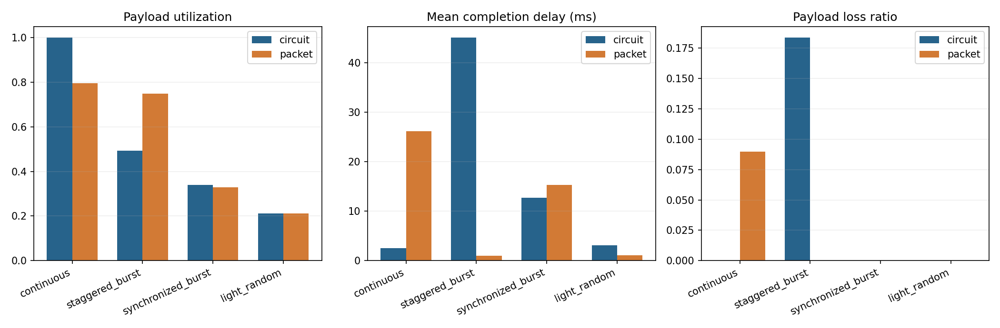
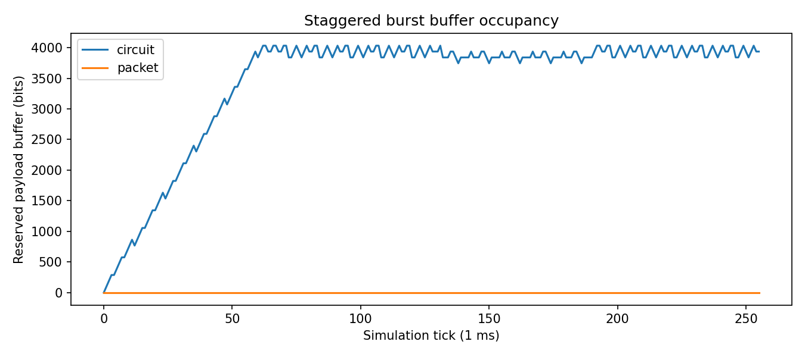
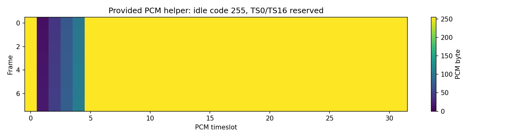

# 实验一报告：电路交换与分组交换的资源利用率比较

姓名：陈梓潮　学号：2024280220　GitHub：alvin11vct11　提交编号：37 编号（创建后回填）

## 1 实验目的

在同一抽象链路（4 用户、每 tick 128 bit、256 个 tick、4096 bit 缓存）上，用完全相同的到达序列分别运行固定时隙电路交换与共享 FIFO 分组交换，回答三个问题：

1. 固定预留与统计复用分别在什么业务下更有效？
2. 包头开销、缓存准入和观察窗口如何影响有效载荷利用率、时延、丢失与积压？
3. 为什么“线路更忙”“平均时延更低”都不能单独作为“更高效”的证据？

本实验不评价真实互联网或电信系统的总体优劣，只比较单链路、已建立连接下的承载模型。

## 2 原理和模型

**固定时隙电路**：tick 对用户数取模决定本时隙服务谁（`tick % 4`），该用户可在一个时隙内连续发送多条记录，空时隙保持空闲，不能借给其他用户。电路记录不增加包头，`remaining_wire_bits` 初值等于 payload。

**共享 FIFO 分组**：所有用户共用一个队列，每条记录在准入时一次性增加 32 bit 包头，之后可跨 tick 续传，但不得与其他记录交错，也不能因为长度超过一个时隙就丢弃。

**缓存与准入**：两模型共用 4096 bit 总缓存，按“未完成记录的原始 payload”预留，已发出但未完整交付的记录仍占满额；放不下时整条记录尾丢弃。该规则是课堂模型，不等同于真实设备的存储计量。

**事件时序**（决定了所有数值的口径）：

```
tick t：到达 → 准入（可能整条丢弃）→ 发送（≤128 bit）
tick t+1 边界：完整发送的记录交付，delay_ticks = (t+1) − arrival_tick
```

- 到达先于发送，因此同一 tick 到达的记录当 tick 就能被发出；
- 完成时延按**完成边界减到达时刻**计算，tick 0 到达、tick 0 发完的记录时延是 1 ms 而不是 0；
- 观察窗口为 `[0, 256)`，窗口结束立即停止，不追加排空，未完成记录全部计入积压（不算丢弃）；
- 部分发送只扣减 `remaining_wire_bits`，不改变 `payload_bits`，也不计入交付。

**指标口径**：`payload_utilization` 只算完整交付的 payload；`wire_utilization` 算实际发出的线路比特，含包头与未完成记录的已发部分；无完成记录时时延为 `None`；守恒式 `generated = delivered + dropped + backlog` 必须成立。

**与 PCM 示例的区别**：PCM 辅助示例是 32 时隙 × 8 bit × 8000 帧/s = 2.048 Mbit/s 的成帧演示，与本实验 128 kbit/s 的抽象比较链路不是同一个速率模型，不能混用。

## 3 手工推演

按 PRD 6.1 的 2 用户例子先手算：2 用户、2 tick、每 tick 1 ms、容量 128 bit、包头 32 bit、缓存充足，只有 tick 0 的用户 1 到达一条 96 bit 记录。

| tick | 服务用户 | 电路：发送/结果 | 分组：发送/结果 |
|---|---|---|---|
| 0 | 用户 0 / 共享队列 | 用户 0 队列空，发送 0，用户 1 等待 | 队首 96+32=128，发 128，记录完成（边界 1） |
| 1 | 用户 1 / 共享队列 | 发 96，记录完成（边界 2） | 队列空，发送 0 |

手算预期：两者有效载荷利用率都是 96/256 = 37.5%；线路忙碌率电路 96/256 = 37.5%，分组 128/256 = 50%；完成时延电路 2 ms、分组 1 ms。运行 `simulate` 后逐项核对，结果与手算完全一致（37.5%、37.5%/50%、2 ms/1 ms），说明实现的事件时序和口径正确。

这个例子已经说明：**相同的有效载荷利用率不代表相同的时延，也不代表相同的线路成本**。

## 4 实验结果

默认配置（4 用户、256 tick、128 bit/tick、tick_ms=1、包头 32 bit、缓存 4096 bit、seed 2026）下的 8 组结果：

| 业务 | 模型 | 有效载荷利用率 | 线路忙碌率 | 平均/最大时延 (ms) | 丢失率 | 积压 (bit) |
|---|---|---:|---:|---:|---:|---:|
| continuous | 电路 | 100.0% | 100.0% | 2.5 / 4.0 | 0 | 0 |
| continuous | 分组 | 79.7% | 100.0% | 26.1 / 40.0 | 9.0% | 3712 |
| staggered_burst | 电路 | 49.2% | 49.5% | 45.1 / 127.0 | 18.4% | 3936 |
| staggered_burst | 分组 | 75.0% | 100.0% | 1.0 / 1.0 | 0 | 0 |
| synchronized_burst | 电路 | 34.0% | 34.4% | 12.7 / 24.0 | 0 | 1152 |
| synchronized_burst | 分组 | 32.8% | 43.8% | 15.4 / 32.0 | 0 | 1536 |
| light_random | 电路 | 21.1% | 21.1% | 3.1 / 10.0 | 0 | 0 |
| light_random | 分组 | 21.1% | 28.1% | 1.1 / 2.0 | 0 | 0 |

守恒核对（生成 = 交付 + 丢弃 + 积压，单位 bit）：

| 业务/模型 | 生成 | 交付 | 丢弃 | 积压 |
|---|---:|---:|---:|---:|
| continuous/电路 | 32768 | 32768 | 0 | 0 |
| continuous/分组 | 32768 | 26112 | 2944 | 3712 |
| staggered_burst/电路 | 24576 | 16128 | 4512 | 3936 |
| staggered_burst/分组 | 24576 | 24576 | 0 | 0 |
| synchronized_burst/电路 | 12288 | 11136 | 0 | 1152 |
| synchronized_burst/分组 | 12288 | 10752 | 0 | 1536 |
| light_random/电路 | 6912 | 6912 | 0 | 0 |
| light_random/分组 | 6912 | 6912 | 0 | 0 |







**continuous（每 4 tick 每人 128 bit）**：电路的供给与 4 个时隙严格对齐，链路 100% 满载、零积压，时延 1～4 ms。分组每条记录 128+32=160 bit，需求 40960 bit 超过窗口容量 32768 bit，线路虽然 100% 忙碌，但 9.0% 的 payload 被尾丢弃、3712 bit 留作积压，平均时延被排队拉到 26.1 ms。**同样 100% 的线路忙碌率，分组多出来的忙碌全部是包头。**

**staggered_burst（每 tick 一条 96 bit，64 tick 换人）**：热点用户只拥有 1/4 的时隙，瞬时 96 bit/tick 的到达远超其 32 bit/tick 的预留，队列在 60 个 tick 左右涨到 4096 bit 缓存上限并开始丢弃，线路忙碌率只有 49.5%。分组每条记录恰好 96+32=128 bit，一 tick 一条，256 条正好用满 32768 bit，零丢失、零积压、时延 1 ms。**这是统计复用最典型的胜利：突发集中在少数用户时，共享队列能把空时隙利用起来。**

**synchronized_burst（每 80 tick 每人集中 8 条 96 bit）**：两种方式都没有丢包，但窗口末尾的突发都来不及排空。电路按用户并行排队、无包头，交付了 11136 bit（34.0%）；分组的包头开销占用了 3584 bit 线路容量，只交付 10752 bit（32.8%），积压 1536 bit，且 FIFO 把 32 条记录串行化，最大时延达到 32 ms。**这里分组线路更忙（43.8% 对 34.4%），交付反而更少、时延更大——更高的利用率不等于更高的效率。**

**light_random（每用户每 tick 以 0.08 概率生成 96 bit）**：两者都交付全部 6912 bit。电路要等自己的时隙，平均时延 3.1 ms、最大 10 ms；分组随到随发，平均 1.1 ms、最大 2 ms。分组的代价是 9216 bit 线路发送量（28.1%）对电路的 6912 bit（21.1%），多出的部分正好是 32 bit 包头。

**一个“利用率与时延指向不同结论”的例子**：continuous 中两种模型的线路忙碌率都是 100%，但电路交付了全部 32768 bit、平均 2.5 ms；分组只交付 26112 bit、平均 26.1 ms，还丢了 2944 bit。如果只看“线路利用率”，会得出两者一样高效的错误结论；把交付量、丢失和积压放在一起看，才能看出分组的包头在满载时是净损失。

## 5 自拟反例

`student_tests/test_my_case.py` 包含两个独立设计的用例，数字与教师 AC 用例不同，先手算再断言。

**反例 1：部分发送被误记为完成（`test_partial_send_and_window_backlog`）**

输入：1 用户、3 tick、128 bit/tick；tick 0 到达 200 bit，tick 2 到达 300 bit。
手算：tick 0 发 128（余 72）；tick 1 发 72 完成（边界 2）；tick 2 为新记录发 128（余 172）；窗口结束。

预期：生成 500、交付 200、丢弃 0、积压 300（原始 payload，而不是剩余 172），线路发送 128+72+128=328，平均时延 2 ms。
若实现把部分发送的记录提前 `pop` 或计入交付，`delivered` 会变成 500 或时延样本多一条；若积压按剩余比特统计，会得到 172。断言同时覆盖这两个错误。

**反例 2：包头重复计算或长分组被丢弃（`test_packet_header_once_across_ticks`）**

输入：1 用户、4 tick、128 bit/tick；tick 0 到达 300 bit 分组。
手算：线路比特 300+32=332，tick 0 发 128（余 204）、tick 1 发 128（余 76）、tick 2 发 76 完成，边界 3。

预期：`wire_sent_bits=332`、交付 300、零丢失、平均时延 3 ms。若每 tick 重复加包头，线路比特会变成 384；若按“超过一个时隙就丢弃”处理，交付会变成 0。这两个错误在只看最终利用率时都可能被掩盖。

运行 `pytest student_tests -q`，2 项全部通过。

## 6 分析与限制

**统计复用什么时候占优？** 当业务在用户间和时间上不均匀时（staggered_burst、light_random），共享 FIFO 可以把电路模式下闲置的时隙利用起来，代价是 32 bit/记录的包头和排队时延。当业务恰好均匀且持续满载时（continuous），包头成为纯开销，固定预留反而没有浪费。

**为什么不能把未完成数据当成丢包？** 积压是“还在系统里但没交付”的数据，丢包是“被准入规则拒之门外”的数据，两者的成因和补救方式不同。本实验在窗口结束不排空，因此连续满载的分组场景会同时出现丢弃和积压；把积压当作 0 会虚高利用率。

**为什么不能只看成功记录的平均时延？** 平均时延只统计完成的记录。缓存 512 bit 的附加实验中，continuous/分组 的平均时延从 26.1 ms 降到 3.5 ms，但丢失率从 9.0% 升到 19.9%——低时延是靠丢弃换来的。报告中的时延必须和交付量、丢失率、积压一起读。

**本实验的边界**：单链路、已建立连接、无建链/传播/误码/重传/多跳；缓存计量是课堂约定；256 个 tick 的有限窗口不等于无限长稳态。结论只适用于这些假设下的比较，不能外推到真实网络。参数变化分析见 `results/extra/`（包头 0/16/32/64 bit、缓存 512～8192 bit），结论随参数变化的趋势与上述分析一致。

## 7 AI使用说明

本次实验的代码补全、数据生成和报告初稿由 AI 助手（DeepSeek Harness）按 PRD 完成，作者负责复核手算、反例与结论后再提交。详细过程见 `AI_LOG.md`。

一个核心循环（`serve_packet` 与 `serve_circuit` 共用）：

```python
while budget > 0 and queue:
    record = queue[0]
    send = min(budget, record.remaining_wire_bits)
    record.remaining_wire_bits -= send
    budget -= send
    wire_bits += send
    if record.remaining_wire_bits == 0:
        queue.popleft()
        completed.append(record)
```

`min(budget, remaining_wire_bits)` 保证一条记录不会被超额发送，`remaining_wire_bits == 0` 才出队保证部分发送不被误记为完成，循环条件保证发完一条后继续使用剩余预算。电路与分组的差别只在“取哪个队列”：电路取 `queues[tick % users]`，分组取共享队列。

一个验证决策：先按 2 用户手算得到 37.5%、37.5%/50%、2 ms/1 ms，再运行代码逐项比对；8 组结果逐项检查守恒式，并单独构造缓存 512 bit 的参数实验，确认“低时延可能来自高丢弃”，从而没有把平均时延当作唯一结论。

## 8 参考资料

1. 课程仓库 README：https://github.com/jwentong/modern-switching-experiment-01
2. `docs/model_contract.md`、`docs/theory_circuit.md`、`docs/theory_packet.md`
3. 实验一 PRD（V1.2，2026-10-18）
4. 本仓库 `README.md`、`src/models.py`、`src/utils.py` 及各任务函数 docstring
5. GitHub Docs：Fork 仓库、从 Fork 创建 PR、批准 Fork 工作流
